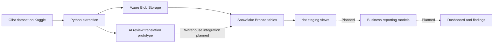

# Olist Marketplace Data Pipeline

*E-Commerce Operations Analytics with AI Review Enrichment*

**Python · Azure Blob Storage · Snowflake · dbt · Groq**

A data engineering portfolio project that extracts Olist marketplace data, uploads it to Azure Blob Storage, and prepares it for analysis in Snowflake using SQL and dbt. An AI-assisted translation prototype explores making Portuguese customer reviews accessible to English-speaking analysts.

**Project status:** Ingestion code, warehouse loading SQL, and five dbt staging models are implemented. Business reporting models, dashboards, and complete review-enrichment integration are planned. Implemented code and declared tests do not establish a successful end-to-end run or passing warehouse tests.

## Business problem

Marketplace operations teams need to understand where orders are delayed, how performance varies across sellers and regions, and how fulfillment relates to customer satisfaction. Investigating these questions requires combining separate datasets containing orders, order items, payments, customers, sellers, products, and reviews.

These datasets have different levels of detail and require consistent definitions and quality checks before they can support reliable reporting. Portuguese review text also creates an accessibility barrier for English-speaking analysts.

This project uses Olist's public e-commerce dataset to model that business scenario. It is an independent portfolio project, with no claim that Olist commissioned it or that it has delivered measured business improvements.

## Project objective

Build a reproducible cloud data pipeline that provides documented, standardized, and validated datasets for investigating marketplace operations and customer experience.

The intended business outputs are:

- **Fulfillment performance:** delivery duration, late-delivery rate, and regional patterns.
- **Seller performance:** sales and fulfillment metrics with explicit calculation rules.
- **Customer experience:** review scores and translated feedback associated with fulfillment outcomes.

These outputs are planned analytical use cases; findings and dashboards will be added as the project develops.

## Architecture



The current extraction script translates a review sample before uploading the CSV files. The translation output is not yet supported by the Snowflake review-table schema.

## Current implementation

| Component | Implementation |
| --- | --- |
| Extraction | Kaggle API download of `olistbr/brazilian-ecommerce` |
| Cloud upload | Python upload to the Azure Blob Storage container `ecommerce-raw` |
| Warehouse setup | Snowflake warehouse, database, Bronze schema, Azure storage integration, external stage, and CSV format |
| Raw loading | Table definitions and `COPY INTO` statements for nine datasets |
| Transformation | Five dbt staging views: orders, customers, sellers, products, and product-category translations |
| Data quality | Declared uniqueness, required-field, accepted-value, and relationship tests |
| AI enrichment | Groq-based translation prototype processing the first 50 review rows |
| Dependencies | Python project configuration and a `uv.lock` file for reproducible dependency resolution |

## Repository structure

```text
.
├── README.md
├── .env.example                 # Empty credential template
├── .gitignore                   # Excludes credentials, data, and generated files
├── .python-version
├── pyproject.toml
├── uv.lock
├── main.py                      # Extraction and upload entry point
├── src/ai_ecommerce_pipeline/
│   └── extract_kaggle.py         # Kaggle extraction, translation, and Azure upload
├── snowflake_bootstrap/
│   ├── 01_setup_infrastructure.sql
│   └── 02_create_stage_and_raw.sql
└── ecomm_transform/
    ├── dbt_project.yml
    └── models/staging/olist/     # Source definitions, staging models, and tests
```

The public project name does not require changing the existing Python package or dbt project names.

## Local setup

Prerequisites: Python 3.12 or newer, `uv`, Kaggle API credentials, an Azure Storage account, a Snowflake account, and a Groq API key for the translation prototype. Configure Kaggle authentication separately according to the API's instructions.

From the project root, install the pinned dependencies:

```bash
uv sync --locked
```

Create a local environment file from the empty template and supply your own values:

```bash
cp .env.example .env
```

Configure the dbt connection separately in `~/.dbt/profiles.yml`, using the profile name `ecomm_transform` and environment variables or a suitable key-pair authentication setup. Keep actual connection credentials out of the repository. The SQL bootstrap scripts currently contain environment-specific Azure identifiers and must be adapted to your own cloud resources.

Check dbt project configuration after setting up the profile:

```bash
uv run dbt parse --project-dir ecomm_transform
```

Parsing checks project configuration; `dbt debug`, `dbt run`, and `dbt test` require a working Snowflake connection. Warehouse execution results should be recorded separately from configuration checks.

## Current limitations

- The review translation prototype overwrites the downloaded reviews CSV with the first 50 rows plus an `english_translation` column. Preserve the full source dataset and separate enrichment output before expanding this step.
- The Snowflake `order_reviews` table currently contains only the original seven columns, so the enriched CSV and loading schema must be reconciled.
- Raw-loading statements use `ON_ERROR = 'CONTINUE'`. Load errors and source-to-target counts need explicit reconciliation to establish completeness.
- Monetary fields currently use floating-point types. Financial reporting models should adopt suitable fixed-point precision.
- Business reporting models, dashboards, scheduling, automated retries, and CI checks are not yet implemented.

## Completion roadmap

1. Preserve full raw reviews, store translations separately, and integrate enrichment into Snowflake with quality and cost tracking.
2. Complete staging models for order items, payments, reviews, and geolocation; correct source definitions and verify warehouse tests.
3. Build core and reporting models with documented grains and metrics. Avoid inflating order counts or amounts when joining order items, payments, and reviews.
4. Add ingestion reconciliation, repeatable reruns, failure handling, and scheduling. Since the source is a historical dataset, demonstrate incremental processing through clearly labeled simulations if added.
5. Add Git-based checks and continuous integration, with warehouse checks using an appropriately restricted identity.
6. Publish a dashboard and a short case study linking business questions to model definitions, findings, and supported recommendations.

## Dataset and attribution

Source: [Brazilian E-Commerce Public Dataset by Olist](https://www.kaggle.com/datasets/olistbr/brazilian-ecommerce).

Source data and credentials are excluded from this repository. Follow the dataset's published license and terms when downloading or redistributing it. The product-category translation dataset is provided by the source; the customer-review translation prototype is the AI enrichment developed in this project.
