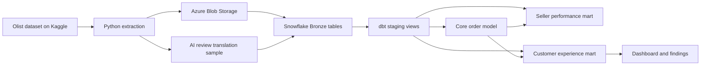

# Olist Marketplace Pipeline: Case Study

## 1. Executive summary

This project builds a validated analytics pipeline for the Olist marketplace dataset. It extracts historical e-commerce data from Kaggle, and uploads the raw files to Azure Blob Storage, loads them into Snowflake Bronze tables, and transforms them with dbt.

The warehouse contains 10 staging models, a one-row-per-order core model, a seller-performance mart, and a customer-experience mart with a small AI-assisted review translation sample. The design emphasizes grain protection, pre-aggregation, documented source contracts, and reproducible quality checks.

The complete dbt graph passed 135 checks with zero warnings and errors. Bronze reconciliation also matched expected row counts for all 10 datasets. Because the source is historical, the project demonstrates a validated batch analytics workflow rather than a continuously running production system.

## 2. Business problem

The Olist dataset contains 99,441 orders, 112,650 order items, 103,886 payment records, 99,224 reviews, and 3,095 sellers. These datasets support analysis of fulfillment performance, seller operations, and customer experience.

The main analytical questions are:

1. How many orders were delivered late, and how long did fulfillment take?
2. Which sellers handled the greatest order and item volumes?
3. How did delivery outcomes relate to customer review scores?
4. How can a small sample of Portuguese review comments be made accessible to English-speaking analysts?

The engineering challenge is that these datasets have different grains. Orders have one row per order, while items, payments, and reviews can have multiple rows per order. Directly joining them can multiply rows and inflate order counts, revenue, freight totals, and review metrics.

The pipeline solves this by standardizing source data in staging, aggregating child-level records before order-level joins, and publishing models with explicit grains: one row per order, one row per seller, and one row per review.

## 3. Architecture

The pipeline follows a layered batch architecture:



 Python handles source extraction, AI review enrichment, and Azure upload. Snowflake stores the raw Bronze layer. dbt standardizes the source tables, protects model grain, and creates the Core and reporting layers.

The current project is a validated batch pipeline. A future production design would add an orchestrator such as Airflow, run-audit metadata, deterministic monitoring checks, and AI-generated incident summaries.

## 4. Data model and grain

Grain defines what one row represents. Establishing the grain before writing joins prevents accidental duplication and incorrect metrics.


| Layer   | Model                             | Grain                              | Purpose                                             |
| --------- | ----------------------------------- | ------------------------------------ | ----------------------------------------------------- |
| Staging | `stg_olist__orders`               | One row per order                  | Clean order lifecycle fields                        |
| Staging | `stg_olist__order_items`          | One row per order item             | Standardize item and freight amounts                |
| Staging | `stg_olist__order_payments`       | One row per order-payment sequence | Standardize payment values                          |
| Staging | `stg_olist__reviews`              | One row per review                 | Preserve review scores and comments                 |
| Core    | `core_olist__orders`              | One row per order                  | Combine order-level fulfillment metrics             |
| Mart    | `mart_olist__seller_performance`  | One row per seller                 | Aggregate seller volume and delivery metrics        |
| Mart    | `mart_olist__customer_experience` | One row per review                 | Combine review, delivery, and enrichment attributes |

The Core order model aggregates order items, payments, and reviews before joining them to orders. This preserves one row per order and prevents fan-out from inflating item counts, payment totals, freight totals, or review metrics.

The seller-performance mart then aggregates order-level and item-level results by seller. The customer-experience mart preserves the full review population and uses a left join for the smaller AI-enrichment sample.

## 5. Modeling decisions

### Aggregate before joining

Order items, payments, and reviews can contain multiple rows for the same order. Each child dataset is therefore aggregated to the required reporting grain before it is joined to the order model.

This prevents fan out. For example, joining three child tables directly to orders could produce multiple rows for one order and inflate revenue, freight, payment, or review counts.

### Use left joins for population preservation

The core model uses left joins from orders to optional child summaries. This keeps orders that have no items, payments, or reviews visible for data quality analysis insted of silently removing them.

### Use explicit metric definitions

The project defines metrics such as:

- `order_item_count` - number of distinct order items;
- `item_subtotal` - sum of item prices;
- `freight_total` - sum of freight values;
- `payment_total` - sum of payment values;
- `delivery_days` - days between purchase and customer delivery;
- `is_late_delivery` - whether delivery occurred after the estimated date.

### Preserve source data and document anomalies

Source records are not silently deleted because they contain unexpected timestamps, duplicate location observations, or missing child records. Instead, the models expose these conditions through validation queries and documented limitations.

## 6. Data-quality investigation

Validation was treated as part of the modeling work rather than a final step.

### Bronze reconciliation

The raw-load reconciliation compared expected source file counts with Snowflake bronze counts for all 10 datasets. Every dataset matched with a row difference of zero.

### dbt quality checks

The complete dbt graph passed 135 checks with zero warnings and zero errors. The checks covered:

- required fields;
- unique keys;
- accepted order statuses and review scores;
- relationships between orders, customers, products, sellers, and reviews;
- one-row-per-order and one-row-per-seller grain.

### Source-data observations

The investigation also identified conditions that should remain visible to analysts:

- 7,827 orders were classified as late;
- 2,965 orders had no customer-delivery timestamp;
- 775 orders had no item records;
- 1 order had no payment record;
- 768 orders had no review;
- geolocation contained duplicate location observations and three coordinates outside the observed coordinate bounds;
- historical timestamp inconsistencies were present in the source data.

These observations were documented rather than silently removed. This preserves traceability and prevents the cleaned models from hiding source-data limitations.

## 7. Business findings

The validated models support several descriptive findings:

- The dataset contains 99,441 orders.
- 88,649 orders were delivered on time, while 7,827 were classified as late.
- The average delivery duration was approximately 12.5 days, with observed delivery durations ranging from 0 to 210 days.
- The seller mart contains 3,095 sellers, 100,010 distinct seller-order relationships, and 112,650 seller-item rows.
- The aggregated item subtotal was 13,591,643.70, and the aggregated freight total was 2,251,909.54.
- The overall average review score was approximately 4.09 out of 5.
- The customer-experience data contains 99,224 reviews, while 768 orders have no review record.

These results are descriptive findings from a historical dataset. They identify patterns for further investigation but should not be interpreted as current operational SLAs, causal relationships, or measured business impact.

## 8. AI review enrichment

The ingestion process creates a small AI-enriched review sample before uploading the files to Azure Blob Storage. The prototype sends the first 50 review rows to a Groq-powered translation function and writes the original review fields together with an `english_translation` field.

The enrichment result was validated separately:

- sample size: 50 rows;
- nonblank translations: 21;
- blank source comments: 29;
- translation errors: 0;
- full review population: 99,224 rows.

The full review table remains the authoritative source for review analysis. The enrichment table is joined with a left join so that the 50-row prototype cannot reduce the full review population.

This is an AI-assisted prototype, not a complete translation of the dataset. Future enrichment could add language detection, sentiment classification, issue-topic extraction, model metadata, processing timestamps, and structured error tracking.

## 9. Reproducibility and validation

The project uses `uv.lock` to keep Python dependencies reproducible. From the repository root, the local validation command checks Python syntax, dbt parsing, and Git whitespace:

```bash
uv sync --locked
./scripts/validate.sh
```

The local validation command checks Python syntax, dbt parsing, and Git whitespace.

With a working Snowflake profile:

```
cd ecomm_transform
dbt build
```

The final regression build completed with:

```
PASS=135 WARN=0 ERROR=0 SKIP=0
```

Bronze reconciliation is run separately in Snowflake using:

```
snowflake_bootstrap/03_reconcile_raw_loads.sql
```

The reconciliation matched expected and loaded row counts for all 10 datasets.

## 10. Limitations

- The source is historical rather than continuously arriving.
- The AI translation prototype processes only 50 reviews.
- Blank review comments remain untranslated.
- Reconciliation uses fixed expected source counts.
- Dashboard publication is not yet implemented.
- Airflow scheduling, retries, notifications, and run-history logging are not yet implemented.
- Hosted GitHub Actions is not enabled; local validation is available instead.

## 11. Future production design

A production version could use:

```
Airflow DAG
  → extract source data
  → upload to Azure
  → load Snowflake Bronze
  → reconcile row counts
  → run dbt build
  → record audit metrics
  → summarize failures with AI
  → notify stakeholders
```

Monitoring should use deterministic checks for row counts, schema, null rates, duplicates, and dbt failures. AI should explain or prioritize failures, not replace the quality checks.

## 12. Conclusion

This project demonstrates an end-to-end batch analytics workflow using Python, Azure Blob Storage, Snowflake, dbt, and AI-assisted review enrichment.

The main engineering lesson is that reliable analytics depends on explicit grain definitions, pre-aggregation before joins, source reconciliation, documented quality checks, and honest treatment of source-data limitations.

The pipeline is validated and portfolio-ready as a batch data-engineering project. Dashboards and orchestration are logical next steps for demonstrating production operation.
